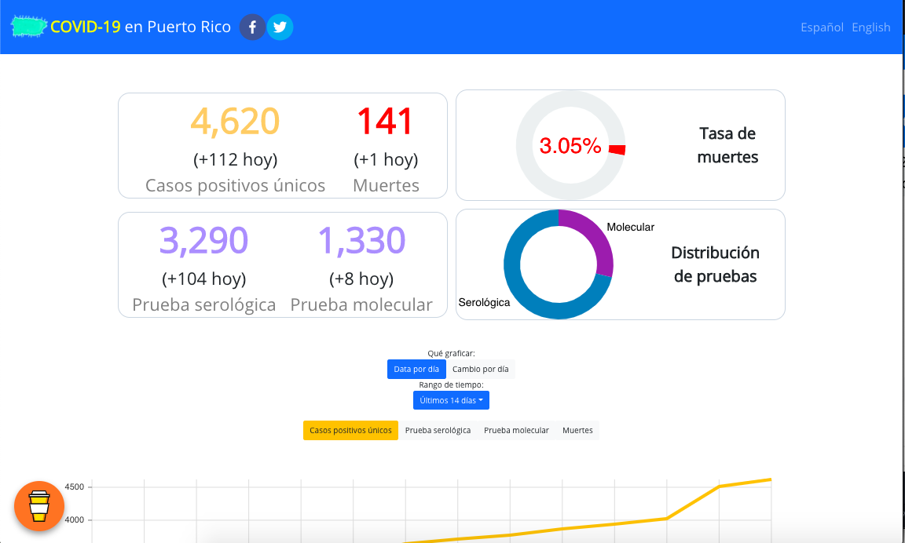
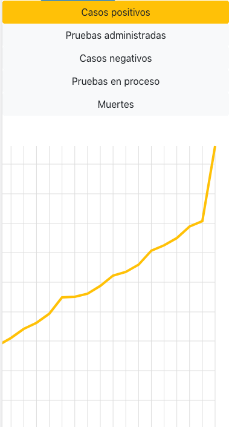

# COVID-19 Puerto Rico Web Tracker

A bilingual (Spanish/English) COVID-19 data visualization dashboard for Puerto Rico, providing real-time statistics on cases, deaths, testing, and vaccination progress.




## Overview

This web application served as a public health information dashboard during the COVID-19 pandemic, tracking and communicating critical data to the Puerto Rican population. Key features include:

- **Real-time Statistics**: Confirmed cases, deaths, and testing data
- **Interactive Charts**: Time-series visualizations with customizable date ranges
- **Vaccination Tracking**: Progress toward herd immunity with visual indicators
- **Excess Deaths Data**: CDC data integration via Tableau
- **Public API**: Developer access for COVID-19 data
- **Bilingual Interface**: Full Spanish and English support

## Architecture

```
┌─────────────────────────────────────────────────────────────────────────┐
│                         DATA PIPELINE                                   │
├─────────────────────────────────────────────────────────────────────────┤
│                                                                         │
│   ┌─────────────────────┐      ┌─────────────────────┐                  │
│   │  PR Health Dept     │      │  CDC / External     │                  │
│   │  Data Sources       │      │  Data Sources       │                  │
│   └─────────┬───────────┘      └─────────┬───────────┘                  │
│             │                            │                              │
│             ▼                            ▼                              │
│   ┌─────────────────────────────────────────────────────┐               │
│   │           Data Scraping Server                      │               │
│   │  github.com/williamrodz/server-covid19pr            │               │
│   └─────────────────────┬───────────────────────────────┘               │
│                         │                                               │
│                         ▼                                               │
│   ┌─────────────────────────────────────────────────────┐               │
│   │              Firebase Firestore                     │               │
│   │  ┌─────────────┐ ┌─────────────┐ ┌───────────────┐  │               │
│   │  │ todaysData  │ │ historical  │ │ vaccination   │  │               │
│   │  │             │ │ Data        │ │ Data          │  │               │
│   │  └─────────────┘ └─────────────┘ └───────────────┘  │               │
│   └─────────────────────┬───────────────────────────────┘               │
│                         │                                               │
└─────────────────────────┼───────────────────────────────────────────────┘
                          │
┌─────────────────────────┼───────────────────────────────────────────────┐
│                         ▼           WEB APPLICATION                     │
├─────────────────────────────────────────────────────────────────────────┤
│                                                                         │
│   ┌─────────────────────────────────────────────────────┐               │
│   │              React Application                      │               │
│   │                                                     │               │
│   │  ┌───────────────┐  ┌───────────────────────────┐   │               │
│   │  │ NavigationBar │  │      Home Dashboard       │   │               │
│   │  │ (Lang Toggle) │  │  ┌─────────┐ ┌─────────┐  │   │               │
│   │  └───────────────┘  │  │ Stats   │ │ Charts  │  │   │               │
│   │                     │  │ Blocks  │ │ (Nivo)  │  │   │               │
│   │  ┌───────────────┐  │  └─────────┘ └─────────┘  │   │               │
│   │  │  API Page     │  │  ┌─────────┐ ┌─────────┐  │   │               │
│   │  │  (Developer   │  │  │ Vaccine │ │ Herd    │  │   │               │
│   │  │   Access)     │  │  │ Stats   │ │ Immunity│  │   │               │
│   │  └───────────────┘  │  └─────────┘ └─────────┘  │   │               │
│   │                     └───────────────────────────┘   │               │
│   │  ┌───────────────┐                                  │               │
│   │  │ Excess Deaths │  ← Tableau Integration           │               │
│   │  │ Page          │                                  │               │
│   │  └───────────────┘                                  │               │
│   └─────────────────────────────────────────────────────┘               │
│                         │                                               │
│                         ▼                                               │
│   ┌─────────────────────────────────────────────────────┐               │
│   │              Firebase Hosting                       │               │
│   └─────────────────────────────────────────────────────┘               │
│                                                                         │
└─────────────────────────────────────────────────────────────────────────┘
```

## Related Repositories

| Repository | Description |
|------------|-------------|
| **[server-covid19pr](https://github.com/williamrodz/server-covid19pr)** | Data scraping server that collects COVID-19 statistics from Puerto Rico's health department and populates the Firebase database |
| **This repo** | Web frontend for visualizing the data |

## Tech Stack

| Category | Technology |
|----------|------------|
| **Frontend** | React 16, React Router, React Bootstrap |
| **Charts** | Nivo (@nivo/line, @nivo/pie), Tableau |
| **Backend** | Firebase (Firestore, Auth, Hosting) |
| **Styling** | Bootstrap 4, CSS |
| **i18n** | Custom bilingual labels (es-pr / en-us) |

## Project Structure

```
src/
├── index.js                 # App entry point with routing
├── components/
│   ├── Home/                # Main dashboard
│   ├── Firebase/            # Firebase config & context
│   ├── Common/              # Shared utilities & i18n labels
│   ├── LineChart/           # Time-series chart component
│   ├── NavigationBar/       # Header with language toggle
│   ├── API.js               # API registration page
│   ├── ExcessDeathsPage/    # CDC excess deaths (Tableau)
│   ├── *Block.js            # Stats display components
│   └── ...
├── constants/
│   └── routes.js            # Route definitions
└── fonts/                   # Custom fonts
```

## Routes

| Path | Description |
|------|-------------|
| `/` | Main dashboard with all statistics |
| `/excessDeaths` | Excess deaths visualization (CDC data) |
| `/api` | API registration and documentation |

## Getting Started

### Prerequisites

- Node.js (v12+)
- Yarn

### Installation

```bash
# Clone the repository
git clone https://github.com/williamrodz/covid19-puertorico-web.git
cd covid19-puertorico-web

# Install dependencies
yarn install

# Start development server
yarn start
```

The app will open at [http://localhost:3000](http://localhost:3000).

### Environment Variables

The app requires Firebase configuration. Create a `.env` file with:

```
REACT_APP_API_KEY=your_firebase_api_key
REACT_APP_AUTH_DOMAIN=your_project.firebaseapp.com
REACT_APP_DATABASE_URL=https://your_project.firebaseio.com
REACT_APP_PROJECT_ID=your_project_id
REACT_APP_STORAGE_BUCKET=your_project.appspot.com
REACT_APP_MESSAGING_SENDER_ID=your_sender_id
REACT_APP_APP_ID=your_app_id
REACT_APP_MEASUREMENT_ID=your_measurement_id
```

## Available Scripts

| Command | Description |
|---------|-------------|
| `yarn start` | Run development server |
| `yarn build` | Build for production |
| `yarn test` | Run tests |

## Deployment

The app is configured for Firebase Hosting:

```bash
yarn build
firebase deploy
```

## Data Model

The Firebase Firestore database contains:

| Collection | Description |
|------------|-------------|
| `data/todaysData` | Current day COVID statistics |
| `data/historicalData` | Time-series data for charts |
| `data/vaccinesToday` | Current vaccination counts |
| `data/vaccineHistory` | Historical vaccination data |
| `users/{uid}` | API user registrations |

## License

This project was created to serve the public health needs of Puerto Rico during the COVID-19 pandemic.
